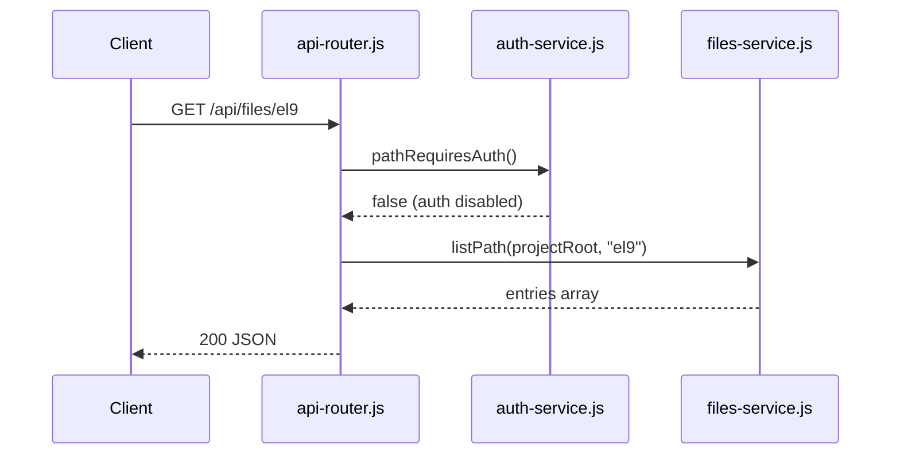

# Design: Project Brain Documentation

## 1. Design Overview

### Purpose

The Project Brain documentation system provides a structured, hand-written Markdown reference for the `files-server-web` repository. It serves as the primary entry point for understanding the project architecture, API behavior, data flows, security model, deployment topology, development workflow, and extension patterns — without requiring source code reading as a first step.

### Documentation Architecture

The system consists of **7 reference documents + 1 index** organized under `docs/`:

```
docs/
├── README.md           (index — navigation hub, not a reference document)
├── ARCHITECTURE.md     (system overview, module graph, env vars)
├── API.md              (REST endpoint reference)
├── DATAFLOWS.md        (sequence and flow diagrams)
├── SECURITY.md         (security model and threat mitigations)
├── DEPLOYMENT.md       (nginx + Node.js deployment)
├── DEVELOPMENT.md      (setup, conventions, error patterns)
└── EXTENDING.md        (extension patterns and guidance)
```

### Intended Audience

- **Human developers** onboarding to the project or making changes
- **AI coding assistants** that need architectural context before modifying source code

Both audiences benefit from the same documents. The index (`README.md`) provides navigation; each reference document provides depth on its topic.

### Why This Structure

The split follows a "one topic, one document" principle. Each document answers a distinct set of questions:

| Document | Answers |
|----------|---------|
| `ARCHITECTURE.md` | What modules exist? How do they connect? What env vars are needed? |
| `API.md` | What endpoints exist? What do they return? What auth is required? |
| `DATAFLOWS.md` | How does a request flow through the system? |
| `SECURITY.md` | How are auth, brute-force, path traversal, and rate limiting handled? |
| `DEPLOYMENT.md` | How is the system deployed? What is the nginx topology? |
| `DEVELOPMENT.md` | How do I set up, code, and test? |
| `EXTENDING.md` | How do I add a new endpoint, module, or component? |

### Document Relationships

```
README.md (index)
  └── links to all 7 reference documents

ARCHITECTURE.md
  ├── cross-references API.md for endpoint details
  ├── cross-references DATAFLOWS.md for flow details
  └── cross-references SECURITY.md for security model

API.md
  ├── cross-references ARCHITECTURE.md for module context
  └── cross-references DATAFLOWS.md for request/response flows

DATAFLOWS.md
  ├── cross-references ARCHITECTURE.md for module context
  └── cross-references SECURITY.md for auth flow details

SECURITY.md
  ├── cross-references ARCHITECTURE.md for module context
  └── cross-references DATAFLOWS.md for auth flow details

DEPLOYMENT.md
  ├── cross-references ARCHITECTURE.md for complete env var inventory
  └── cross-references DEVELOPMENT.md for local setup

DEVELOPMENT.md
  ├── cross-references ARCHITECTURE.md for module context
  └── cross-references DEPLOYMENT.md for production setup

EXTENDING.md
  ├── cross-references ARCHITECTURE.md for module context
  ├── cross-references API.md for endpoint patterns
  └── cross-references DEVELOPMENT.md for conventions
```

---

## 2. Documentation Boundaries

### Source-of-Truth Rules

| Topic | Authoritative Source | What It Owns |
|-------|---------------------|--------------|
| Architecture overview | `docs/ARCHITECTURE.md` | Module graph, request routing, frontend structure, technology stack |
| Complete env var inventory | `docs/ARCHITECTURE.md` | All env vars, defaults, descriptions |
| API behavior | `docs/API.md` | Endpoints, params, responses, auth requirements |
| Data flows | `docs/DATAFLOWS.md` | Request/response sequences, auth flow, boot sequence |
| Security model | `docs/SECURITY.md` | Auth, brute-force, path traversal, rate limiting, headers |
| Deployment | `docs/DEPLOYMENT.md` | nginx topology, SSL, process config, production env vars |
| Development workflow | `docs/DEVELOPMENT.md` | Setup, conventions, error patterns, testing, maintenance |
| Extension guidance | `docs/EXTENDING.md` | Patterns for adding endpoints, modules, components |
| Module implementation details | JSDoc in `lib/*.js` | Function-level docs, `@env` tags, `@security` notes |

### Boundary Rules

1. **JSDoc owns implementation details.** Function signatures, parameter types, internal logic descriptions stay in JSDoc. Reference documents cross-reference JSDoc rather than duplicating it.

2. **ARCHITECTURE.md owns the complete env var inventory.** DEPLOYMENT.md describes only production-relevant variables and links back to ARCHITECTURE.md for the full list.

3. **API.md owns API behavior.** ARCHITECTURE.md mentions endpoints exist but does not document their shapes.

4. **DATAFLOWS.md owns flow descriptions.** Other documents may summarize flows but defer to DATAFLOWS.md for sequence diagrams.

5. **SECURITY.md owns the security model.** Other documents reference security behavior but defer to SECURITY.md for details.

### Cross-Reference Convention

When document A needs to mention a topic owned by document B:

- **Do:** Add a one-line summary + a link to document B
- **Don't:** Copy the full content from document B into document A

Example: `ARCHITECTURE.md` mentions that `api-router.js` handles auth gating, then links to `SECURITY.md` for the auth model details.

---

## 3. Repository-to-Documentation Mapping

### Confirmed Repository Structures

| Repository Path | Document(s) | What It Provides |
|-----------------|-------------|------------------|
| `server.js` | ARCHITECTURE.md, DATAFLOWS.md | Entry point, HTTP server creation, boot sequence |
| `lib/api-router.js` | ARCHITECTURE.md, API.md, DATAFLOWS.md | Route registrations, middleware pipeline, auth gate |
| `lib/files-service.js` | ARCHITECTURE.md, API.md, DATAFLOWS.md | File listing, download, search, releases |
| `lib/auth-service.js` | ARCHITECTURE.md, SECURITY.md, DATAFLOWS.md | Login, JWT, cookies, brute-force, password hashing |
| `lib/rate-limiter.js` | ARCHITECTURE.md, SECURITY.md | IP-based rate limiting |
| `lib/http-utils.js` | ARCHITECTURE.md, DEVELOPMENT.md | Response formatters, JSON body parser, security headers |
| `lib/static-handler.js` | ARCHITECTURE.md, DEPLOYMENT.md | SPA serving, 404, static files, downloads |
| `lib/load-env.js` | ARCHITECTURE.md, DEVELOPMENT.md | .env loading, dotenv fallback |
| `lib/logger.js` | ARCHITECTURE.md, DEVELOPMENT.md | Terminal logging with ANSI colors |
| `lib/idle-timer.js` | ARCHITECTURE.md, DATAFLOWS.md | Client-side session auto-lock |
| `lib/hash-password.js` | ARCHITECTURE.md, DEVELOPMENT.md | CLI utility for password hashing |
| `assets/js/router.js` | ARCHITECTURE.md, DATAFLOWS.md | SPA routing, page navigation |
| `assets/js/home.js` | ARCHITECTURE.md, DATAFLOWS.md | HomePage component, resource cards, search |
| `assets/js/browse.js` | ARCHITECTURE.md, DATAFLOWS.md | BrowsePage component, file table |
| `assets/js/resource-service.js` | ARCHITECTURE.md, DATAFLOWS.md | API client, caching, auth status |
| `assets/js/i18n.js` | ARCHITECTURE.md | Internationalization (en/fa) |
| `assets/js/theme.js` | ARCHITECTURE.md | Dark/light theme toggle |
| `assets/js/autocomplete.js` | ARCHITECTURE.md | Search autocomplete |
| `assets/js/banner.js` | ARCHITECTURE.md | Banner component |
| `assets/js/services/performance-monitor.js` | ARCHITECTURE.md | Performance monitoring |
| `index.html` | ARCHITECTURE.md, DEPLOYMENT.md | SPA shell, script loading order |
| `nginx.conf` | DEPLOYMENT.md | Reverse proxy, SSL, SPA fallback |
| `package.json` | ARCHITECTURE.md, DEVELOPMENT.md | Dependencies (bcrypt, dotenv), scripts |

### Module Dependency Graph (confirmed from `require()` calls)

```
server.js
├── lib/load-env.js
├── lib/logger.js
├── lib/api-router.js
│   ├── lib/rate-limiter.js
│   ├── lib/http-utils.js
│   ├── lib/static-handler.js
│   │   └── lib/http-utils.js
│   ├── lib/files-service.js
│   └── lib/auth-service.js
└── lib/files-service.js (boot-time health check)
```

### Frontend Script Loading Order (confirmed from `index.html`)

```
index.html
├── assets/js/banner.js
├── assets/js/services/resource-service.js
├── assets/js/services/performance-monitor.js
├── assets/js/theme.js
├── assets/js/i18n.js
├── assets/js/autocomplete.js
├── assets/js/home.js
├── assets/js/browse.js
├── lib/idle-timer.js
└── assets/js/router.js
```

---

## 4. Architecture Documentation Strategy

### Backend Module Structure

`ARCHITECTURE.md` represents the backend as a flat list of `lib/` modules with:

- **Module name** (file name without extension)
- **Purpose** (one-line summary)
- **Exports** (public API surface)
- **Internal dependencies** (other `lib/` modules it requires)
- **External dependencies** (npm packages or Node.js built-ins)

Each module entry cross-references the JSDoc header in the source file for implementation details.

### Request Routing

`ARCHITECTURE.md` documents the routing hierarchy:

```
HTTP Request
  → server.js (http.createServer)
    → api-router.js handleRequest()
      → rate-limiter.js checkLimit()
      → auth-service.js (auth gate for protected paths)
      → files-service.js (file operations)
      → static-handler.js (SPA, 404, static files)
```

Route registrations are confirmed from `api-router.js` `if (pathname === ...)` blocks.

### Frontend SPA Structure

`ARCHITECTURE.md` documents the frontend as:

- **Router** (`router.js`): resolves paths to page components
- **Pages** (`home.js`, `browse.js`): render into `#app` container
- **Services** (`resource-service.js`): API client with caching
- **Shared** (`i18n.js`, `theme.js`, `autocomplete.js`, `banner.js`): cross-cutting concerns

### Environment Variables

`ARCHITECTURE.md` contains the complete inventory in a table. The following defaults are drawn from prior repository analysis and **must be directly verified against the current implementation** before being documented as confirmed facts:

| Variable | Required | Default (verify) | Used By | Description |
|----------|----------|---------|---------|-------------|
| `FILES_ROOT` | Yes | — | `files-service.js` | Absolute path to file repository |
| `RELEASE_PVM` | No | — | `files-service.js` | Dedicated PVM release path |
| `AUTH_ENABLED` | No | `false` (verify) | `auth-service.js` | Enable/disable auth gate |
| `AUTH_JWT_SECRET` | If auth on | — | `auth-service.js` | HMAC signing secret (min 32 chars) |
| `AUTH_SESSION_MINUTES` | No | `30` (verify) | `auth-service.js` | Session idle timeout |
| `AUTH_USERS_FILE` | No | `./data/users.json` (verify) | `auth-service.js` | Path to users database |
| `AUTH_MAX_FAILED_ATTEMPTS` | No | `5` (verify) | `auth-service.js` | Brute-force threshold |
| `AUTH_LOCKOUT_MINUTES` | No | `15` (verify) | `auth-service.js` | Lockout duration |
| `PORT` | No | `3000` (verify) | `server.js` | HTTP server port |

### Technology Stack

The following technology stack details are drawn from prior repository analysis. They **must be directly verified against the current implementation** before being documented as confirmed facts:

- **Runtime:** Node.js (no framework)
- **HTTP:** `http` module (built-in)
- **Frontend:** Vanilla JS (IIFE modules, no framework)
- **Auth:** bcrypt + JWT (HMAC-SHA256) + HttpOnly cookies
- **Deployment:** nginx reverse proxy + Node.js process

### Extension Points

`ARCHITECTURE.md` identifies stable extension points:

- New API endpoint: add `if (pathname === ...)` block in `api-router.js`
- New file operation: add function to `files-service.js`
- New auth method: extend `auth-service.js`
- New frontend component: create IIFE module in `assets/js/`, add `<script>` tag in `index.html`
- New env var: add to `load-env.js` parsing + JSDoc `@env` tag

### Evidence Requirements

All architectural relationships must be confirmed by:

- `require()` calls (backend dependencies)
- `<script>` tag ordering (frontend dependencies)
- `if (pathname === ...)` blocks (route registrations)
- Stable function/module names
- Configuration sections in `nginx.conf`

**Graphify is NOT an architectural source of truth.** It may be used as a navigation aid, but inferred or ambiguous relationships must not be presented as confirmed architecture.

### Implementation Detail Verification

Concrete implementation details in this design (env var defaults, API response examples, JWT/cookie behavior, rate limiting, path traversal behavior) are drawn from prior repository analysis. They **must be directly verified against the current implementation** when the corresponding documentation files are actually created. Unverified implementation behavior must not be documented as confirmed fact.

---

## 5. API Documentation Strategy

### Structure

`API.md` documents each endpoint with:

```markdown
### `GET /api/categories`

**Auth:** None

**Parameters:** None

**Response:** `200 OK`
```json
[
  {
    "name": "category-name",
    "path": "category-name",
    "type": "directory",
    "fileCount": 42,
    "folderCount": 3,
    "mtime": "2025-01-01T00:00:00.000Z",
    "latestModified": "2025-01-01T00:00:00.000Z"
  }
]
```

**Errors:**
- `503 FILES_ROOT_MISSING` — `FILES_ROOT` env var not set
- `503 FILES_ROOT_NOT_FOUND` — path does not exist
- `503 FILES_ROOT_EMPTY` — root directory is empty
- `503 FILES_ROOT_NO_CATEGORIES` — no subdirectories found

**Source:** `lib/api-router.js` → `lib/files-service.js` `listCategories()`
```

### Coverage

All endpoints confirmed in `lib/api-router.js`:

| Method | Path | Auth |
|--------|------|------|
| GET | `/api/health` | No |
| GET | `/api/auth/status` | No |
| POST | `/api/auth/login` | No |
| POST | `/api/auth/logout` | No |
| GET | `/api/categories` | No |
| GET | `/api/releases?limit=&os=` | Conditional |
| GET | `/api/search?q=&limit=` | No |
| GET | `/api/files/*` | No |
| GET | `/api/download/*` | Conditional |
| GET | `/`, `/index.html`, `/browse/*` | No (SPA) |
| GET | `/404`, `/404.html` | No |

### Verification Requirement

API response shapes and security requirements **must be verified directly against `lib/api-router.js` and the relevant service implementations** before being documented as confirmed facts. Response shapes are confirmed by reading the `sendJSON()` calls and the return values of service functions.

---

## 6. Data Flow Documentation Strategy

### Flows to Document

`DATAFLOWS.md` must document:

1. **Boot sequence:** `server.js` → `load-env.js` → `logger.js` → `api-router.js` → `files-service.js` `peekRootSync()`
2. **Request → response flow:** generic middleware pipeline
3. **File listing:** `GET /api/files/*` → `files-service.js` `listPath()` → response
4. **Download:** `GET /api/download/*` → `files-service.js` `getDownloadTarget()` → `static-handler.js` `streamDownload()`
5. **Search:** `GET /api/search?q=` → `files-service.js` `searchEntries()` → response
6. **Authentication:** `POST /api/auth/login` → `auth-service.js` `login()` → JWT → cookie
7. **JWT/session verification:** `auth-service.js` `verifySession()` → `verifyJwt()` → cookie extraction
8. **Auth gate:** `api-router.js` → `auth-service.js` `pathRequiresAuth()` → `verifySession()`
9. **Frontend flow:** `router.js` → `home.js`/`browse.js` → `resource-service.js` → API

### Representation

Use **Mermaid sequence diagrams** (GitHub-compatible) for each flow. Keep diagrams focused on the essential steps. Use ASCII diagrams only when Mermaid is insufficient.

Example:



### Verification

Each flow must be traceable to specific source code paths. Do not introduce flows not supported by the repository.

---

## 7. Security Documentation Strategy

### Topics to Cover

`SECURITY.md` must document:

1. **Password hashing:** bcrypt with cost factor 12 (`HASH_COST` in `auth-service.js`)
2. **JWT:** HMAC-SHA256 signing, `jti` claim, `exp`/`iat` claims
3. **Cookie attributes:** HttpOnly, Secure (when HTTPS), SameSite=Strict, Path=/
4. **Brute-force protection:** in-memory `failedAttempts` Map, `AUTH_MAX_FAILED_ATTEMPTS`, `AUTH_LOCKOUT_MINUTES`
5. **Rate limiting:** in-memory IP-based limiter in `rate-limiter.js`, 120 req/min
6. **Path traversal prevention:** `resolveInsideRoot()` in `files-service.js`, symlink checks via `realpathSync()`
7. **Security headers:** CSP, X-Frame-Options, X-Content-Type-Options, Referrer-Policy (in `http-utils.js` `securityHeaders()`)
8. **AUTH_ENABLED:** feature flag behavior — when disabled, all `verify()` calls return `{ ok: true }`
9. **Auth boundaries:** which paths require auth (`pathRequiresAuth()` logic)

### Verification Requirement

The following **must be verified directly against implementation** before being documented as confirmed facts:

- JWT algorithm (confirm `HS256` in `signJwt()`)
- Cookie attributes (confirm `HttpOnly`, `Secure`, `SameSite=Strict` in `buildSessionCookie()`)
- Rate limiting behavior (confirm `RATE_LIMIT_MAX_REQ`, `RATE_LIMIT_WINDOW_MS` in `rate-limiter.js`)
- Brute-force lockout behavior (confirm `recordFailedAttempt()`, `checkLockout()` in `auth-service.js`)
- Path traversal behavior (confirm `resolveInsideRoot()`, `realpathSync()` checks in `files-service.js`)
- Security headers (confirm `securityHeaders()` in `http-utils.js`)
- AUTH_ENABLED behavior (confirm `isAuthEnabled()` calls throughout `auth-service.js`)

### Source References

Every security claim must reference:
- File path + function name (e.g., `lib/auth-service.js` → `buildSessionCookie()`)
- Configuration constant name (e.g., `HASH_COST`, `RATE_LIMIT_MAX_REQ`)

---

## 8. Deployment Documentation Strategy

### Scope

`DEPLOYMENT.md` documents:

1. **nginx architecture:** reverse proxy from `nginx.conf`
2. **SSL/TLS termination:** at nginx (confirmed by `ssl_certificate` directives)
3. **Node.js process:** on port 3000 (confirmed by `proxy_pass http://127.0.0.1:3000`)
4. **FILES_ROOT requirements:** must be set, must exist, must be a directory
5. **Production-relevant env vars:** `FILES_ROOT`, `AUTH_ENABLED`, `AUTH_JWT_SECRET`, `PORT`
6. **SPA fallback behavior:** `@spa` location with `rewrite ^ /index.html last`

### Environment Variables

`DEPLOYMENT.md` describes only production-relevant variables and **links back to `ARCHITECTURE.md`** for the complete inventory. It does NOT duplicate the full table.

### Repository vs. Production Distinction

`DEPLOYMENT.md` clearly distinguishes:

- **Repository-confirmed:** the `nginx.conf` file as it exists in the repo
- **Deployment assumptions:** production environments may customize nginx config, SSL certificates, file paths, and env vars

Example labeling:

> **Repository-confirmed:** nginx proxies `/api/` to `127.0.0.1:3000`.
> **Assumption:** Production may use different SSL certificates, server names, or upstream addresses.

---

## 9. Development Documentation Strategy

### Coverage

`DEVELOPMENT.md` documents:

1. **Local setup:** `npm install`, create `.env`, `node server.js`
2. **`.env` configuration:** link to `ARCHITECTURE.md` for full inventory; show minimal `.env` example
3. **Starting the server:** `npm start` or `node server.js`
4. **Coding conventions:**
   - `'use strict'` at top of every file
   - JSDoc headers for modules (`@file`, `@module`, `@brief`, `@description`)
   - IIFE module pattern for frontend (`const Module = (function () { ... })()`)
   - `serviceError(httpStatus, code, message)` pattern for errors
5. **Error-handling conventions:**
   - `serviceError()` creates `Error` with `.httpStatus` and `.code`
   - `sendServiceError()` in `http-utils.js` formats error responses
   - HTTP status codes: 400 (bad request), 401 (unauthorized), 403 (forbidden), 404 (not found), 429 (rate limited), 500 (server error), 503 (service unavailable)
6. **Current testing state:** no automated tests exist; document manual testing approach
7. **Manual validation:** start server, curl endpoints, verify responses
8. **Documentation maintenance:** link to the maintenance checklist in `ARCHITECTURE.md`

### What NOT to Do

- Do not invent a test framework or CI workflow
- Do not prescribe TDD or any testing methodology not present in the repo
- Do not document testing approaches that require tools not in the repo

---

## 10. Extension Documentation Strategy

### Extension Areas

`EXTENDING.md` provides guidance for:

1. **API endpoints:** add `if (pathname === "/api/...")` block in `api-router.js`, call service function, return `sendJSON()`
2. **File operations:** add exported function to `files-service.js`, follow `resolveInsideRoot()` + `serviceError()` pattern
3. **Authentication methods:** extend `auth-service.js`, follow existing `verifyPassword()` / `signJwt()` patterns
4. **Frontend components:** create IIFE module in `assets/js/`, add `<script>` tag in `index.html`, register with `router.js`
5. **Environment variables:** add to `.env`, document in JSDoc `@env` tag, add to `ARCHITECTURE.md` inventory

### Approach

For each extension area, `EXTENDING.md`:

- Points to the existing repository pattern (file + function name)
- Shows a minimal example based on the existing code style
- Cross-references the relevant reference document (e.g., `API.md` for endpoints, `DEVELOPMENT.md` for conventions)
- Does NOT prescribe unsupported abstractions or patterns not present in the repo

---

## 11. Source Reference Strategy

### Reference Convention

Every significant architectural or behavioral claim must be traceable to:

```
file_path + stable_symbol
```

Where `stable_symbol` is one of:
- Function name (e.g., `listCategories()`)
- Module name (e.g., `lib/auth-service.js`)
- Route registration (e.g., `if (pathname === "/api/categories")`)
- Configuration section (e.g., `nginx.conf` → `location /api/`)
- Heading (e.g., `SECURITY.md` → `### Brute-force protection`)

### Format

```markdown
`lib/files-service.js` → `listCategories()` → returns sorted category array
```

Line numbers may be included optionally but must **never** be the sole reference mechanism:

```markdown
# Good
`lib/auth-service.js` → `buildSessionCookie()` → sets HttpOnly, Secure, SameSite=Strict

# Bad (line number only)
See line 418 of auth-service.js
```

### Why Not Line Numbers

Line numbers shift when code changes. Stable symbols (function names, route paths, config sections) remain valid across refactors.

---

## 12. Confirmed Facts, Assumptions, and Unresolved Details

### Confirmed Facts (verified against source)

- Module dependency graph from `require()` calls
- API endpoints from `api-router.js` route handlers
- Auth flow from `auth-service.js` implementation
- Environment variables from JSDoc `@env` tags and `process.env` reads
- Frontend component structure from `<script>` tags and IIFE exports
- nginx configuration from `nginx.conf`
- Error handling pattern from `serviceError()` usage

### Assumptions (not fully verified)

- Production deployment uses the exact `nginx.conf` in the repo (may be customized per environment)
- No database or external service dependencies beyond filesystem

### Unresolved Implementation Details

- `data/users.json` exact schema — **not directly verified from source.** Do not document its schema unless directly verified against the actual data file or generation logic. Treat as an unresolved implementation detail.

### Tool-Generated Inferences (NOT to be presented as facts)

- Graphify `indirect_call` edges between modules and functions (mislabeled `contains` relationships)
- Graphify `semantically_similar_to` edges between HTML pages (plausible but not architecturally significant)
- Graphify community detection groupings (useful for navigation, not authoritative)

---

## 13. Maintenance and Consistency Strategy

### Maintenance Mapping

| Change Type | Documents to Update |
|-------------|-------------------|
| New API endpoint | `API.md`, `ARCHITECTURE.md` |
| New module or dependency | `ARCHITECTURE.md` |
| Auth/Security change | `SECURITY.md`, `DATAFLOWS.md` |
| New env var | `ARCHITECTURE.md` (complete inventory), `DEPLOYMENT.md` (if production-relevant) |
| Deployment change | `DEPLOYMENT.md` |
| New frontend component | `ARCHITECTURE.md`, `DATAFLOWS.md` |
| Error handling change | `DEVELOPMENT.md` |
| New extension pattern | `EXTENDING.md` |

### Review Checklist

- [ ] All architectural claims verified against source code
- [ ] All API endpoints match `api-router.js` handlers
- [ ] All environment variables documented with correct defaults in `ARCHITECTURE.md`
- [ ] `DEPLOYMENT.md` links back to `ARCHITECTURE.md` instead of duplicating the full env var inventory
- [ ] No duplication with JSDoc (cross-reference instead)
- [ ] No Graphify INFERRED edges presented as facts
- [ ] All confirmed facts marked as confirmed; assumptions marked as assumptions
- [ ] Navigation links between related documents work
- [ ] No broken references to source files
- [ ] All source references include file paths plus stable symbols

### Role of Phase 4 Final Review

The final cross-document review in Phase 4:

1. Verifies all claims against source code
2. Checks navigation links between all documents
3. Confirms no duplication with JSDoc
4. Confirms `DEPLOYMENT.md` does not duplicate the full env var inventory
5. Confirms all acceptance criteria are met

---

## 14. Security, Performance, Compatibility, and Migration Considerations

### Runtime Behavior

- **No runtime behavior changes.** This is a documentation-only change.
- No application source code is modified.
- No configuration files are modified.
- No new runtime dependencies are introduced.

### Migration

- **No application migration required.**
- Documentation files are additive; they do not affect the build, deployment, or runtime.

### Security

- Documentation **must not claim security properties that have not been verified** against source code.
- All security claims in `SECURITY.md` must be traceable to specific functions and constants.
- Unverified claims must be labeled as assumptions or unresolved details.

### Performance

- **No application runtime performance impact is expected** because this change adds repository documentation only and does not modify runtime code or configuration.
- Documentation files are not served by the application.
- `docs/` is not referenced by `nginx.conf` or any application code.

### Compatibility

- Documentation uses GitHub-compatible Markdown with Mermaid diagrams.
- No new tooling or dependencies are required to read the documentation.

### Graphify Independence

- Documentation **does not create a runtime dependency on Graphify** or generated artifacts.
- Graphify may be used as a supporting navigation/analysis tool during documentation maintenance, but it is not required to read or use the documentation.

---

## 15. Implementation Phase Mapping

### Phase 1: Core Architecture (no dependencies)

- Create `docs/README.md` (index)
- Create `docs/ARCHITECTURE.md` (includes complete env var inventory)
- Create `docs/API.md`

### Phase 2: Data Flows & Security (depends on Phase 1)

- Create `docs/DATAFLOWS.md`
- Create `docs/SECURITY.md`

### Phase 3: Operations & Development (depends on Phase 1)

- Create `docs/DEPLOYMENT.md` (production-relevant env vars only; links to `ARCHITECTURE.md`)
- Create `docs/DEVELOPMENT.md`

### Phase 4: Extension Guidance & Final Review (depends on Phase 1; final review depends on Phases 1, 2, and 3)

- Create `docs/EXTENDING.md`
- Final cross-document review against acceptance criteria

### Dependency Summary

| Phase | Depends On |
|-------|-----------|
| Phase 1 | None |
| Phase 2 | Phase 1 |
| Phase 3 | Phase 1 |
| Phase 4 (documentation) | Phase 1 |
| Phase 4 (final review) | Phases 1, 2, and 3 |

**No Phase 5 exists.**
